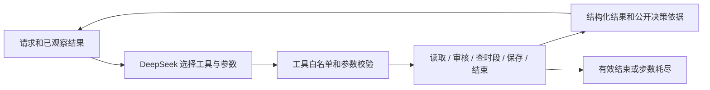

# 02 方案与动态决策

## 调用流程

CLI 校验请求后，针对每个素材创建独立模型上下文，共享 SQLite 草稿库。
每轮发送 system 指令、原始请求、工具定义以及之前真实工具返回。
DeepSeek 生成一个 `tool_calls`，运行器校验参数、执行工具，再用 `role=tool` 和对应 `tool_call_id` 返回结果。
下一轮的动作由模型基于观察结果决定，直到模型调用 `finish`，或达到调用上限。
运行器不根据业务条件预先指定下一工具，工具内部的防护条件只负责拒绝越权操作。

## 真实路径

- 正常：读取 M01 → 规则通过 → 查询确认 20:00 可用 → 保存该时间 → 结束。
- 缺资料：读取 M02 → 规则返回缺少 rights → 模型结束，输出待补充字段。
- 冲突：查询得到 18:00 被占用、19:00 空闲 → 模型选择 19:00 保存待确认草稿。
- 修改占用：进一步占用 19:00 → 模型选择 20:00；原 18:00 硬要求不被修改。
- 保存失败：工具返回 `save_failed` → 模型结束，保存状态为失败。

各路径完整实际参数与结果见 `examples/live-*.output.json`。`reason` 是短决策依据；不采集或提交模型内部思维过程。

## 模块职责

- `src/domain.py`：输入校验、时间处理、审核规则和幂等输入摘要。
- `src/models.py`：DeepSeek HTTP 接入及明确标记的离线测试替身。
- `src/agent.py`：模型—工具观察循环、工具选择协议和步骤上限。
- `src/tools.py`：工具输入校验、业务权限、状态与结果投影。
- `src/store.py`：事务、正式时段唯一约束与请求幂等。
- `src/evaluate.py`：真实运行、业务断言、数据库行数及 Trace 文件生成。

## 工程约束

保存前必须已经读取、审核通过并查询可用时段，写入边界再次检查规则。
SQLite `BEGIN IMMEDIATE` 串行化写事务；`UNIQUE(request_id, material_id)` 防重复；条件唯一索引限制同渠道同时间只能有一个 `ready`。
现有排期来自输入资料；正式草稿占用来自实时数据库。查询与写入之间发生竞争时，数据库唯一索引拒绝第二个写入，返回可重试的 `slot_conflict`，模型可以重查。
返回已有幂等回执优先于测试故障注入，避免重放一个已成功请求时谎报失败。
改变已使用幂等键的输入被拒绝；用户确认使用新请求 ID，不覆盖历史草稿。

当模型提前要求结束、请求不存在工具或伪造授权参数时，工具返回错误，留给下一轮调整；无有效动作直至上限会明确未完成。
生产环境仍需对用户身份做认证，此 CLI 将本地请求文件视为调用方授权输入。

## 取舍

无第三方框架，因此评审不需要理解框架状态机就能定位每一轮动作。代价是工具协议、错误映射与步骤上限由本项目维护。
SQLite 适合单机演示并可验证并发写约束；不声称是分布式排期系统。
DeepSeek 接入采用官方非流式工具调用协议，只支持官方域名，避免把密钥意外发送给任意自定义地址。
调用超时 30 秒，无自动网络重试，默认每项最多 10 轮；素材文本按不可信数据处理，禁止执行其中的指令。
